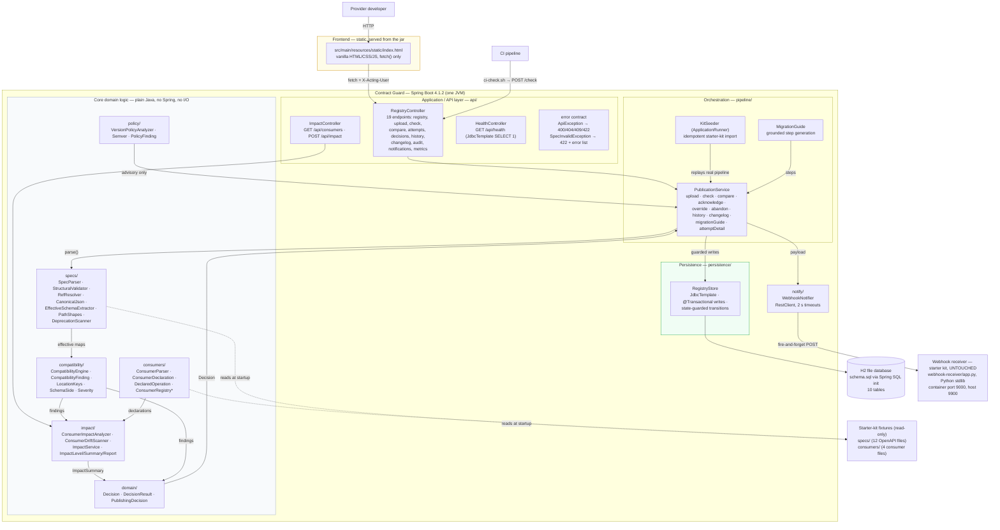
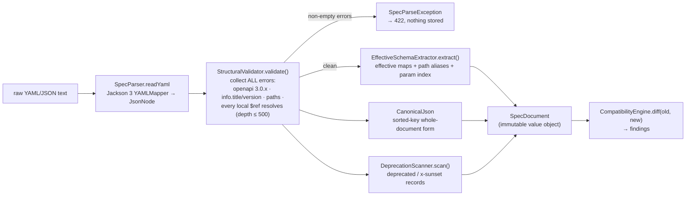
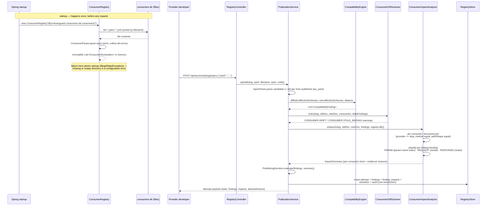
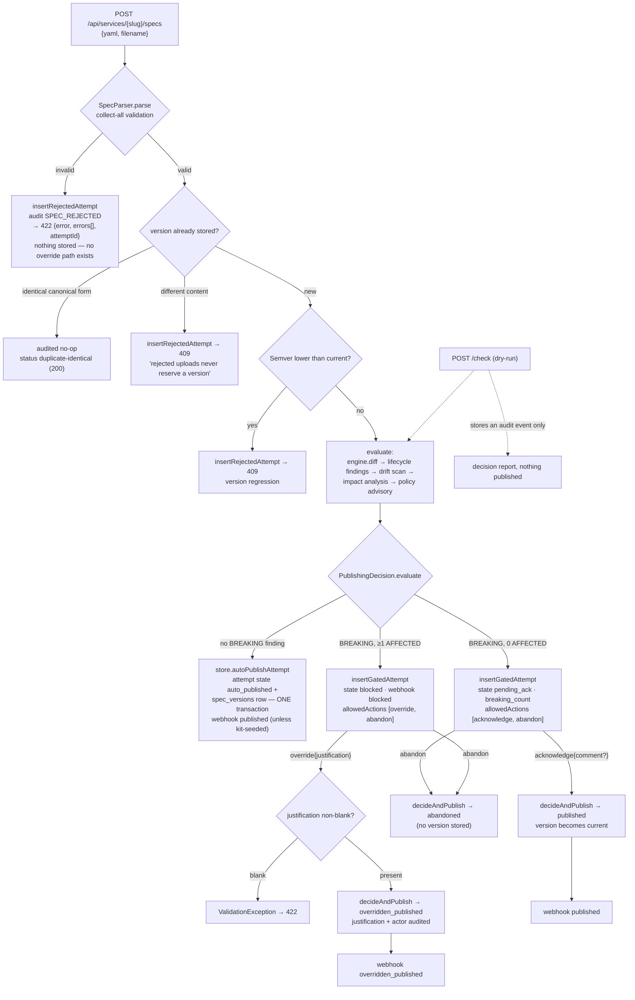
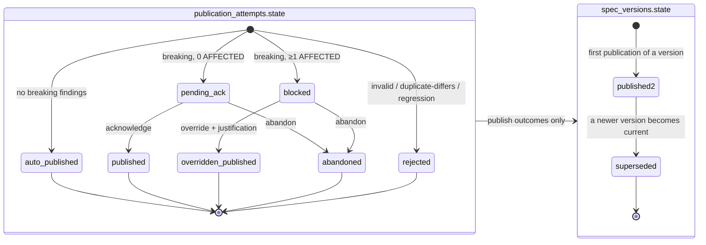
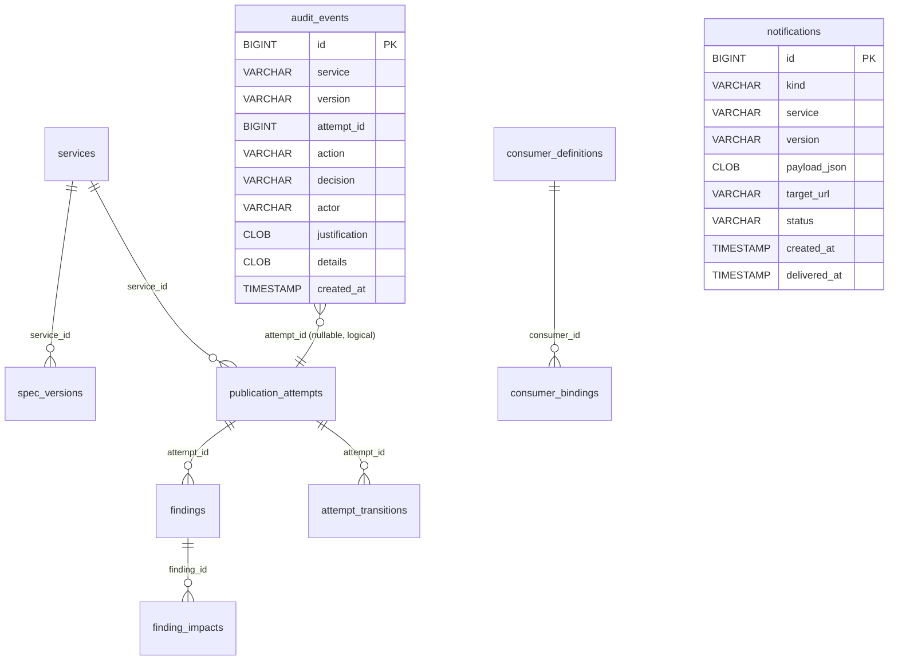
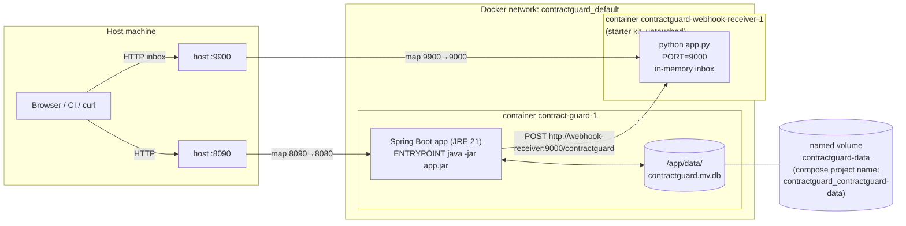

# Contract Guard — System Design

**Status:** implementation-grounded design document for the shipped system at commit
`93ceeff` (Java 17 / Spring Boot 4.1.2, 144/144 tests green, live-verified local Docker
Compose deployment). Every component, class, table, endpoint and state machine described
here exists in the repository — nothing is proposed or aspirational. Proposed work is
confined to the explicitly marked "future" notes and [REVIEW.md](REVIEW.md) §16.

Companion documents: [README.md](README.md) (product overview, quick start) ·
[PLAN.md](PLAN.md) (original plan + as-built audit) · [PROGRESS.md](PROGRESS.md)
(build journey + verification evidence) · [DECISIONS.md](DECISIONS.md) (decision log with
alternatives) · [REVIEW.md](REVIEW.md) (engineering review).

---

## Contents

1. [System overview](#1-system-overview)
2. [High-level architecture](#2-high-level-architecture)
3. [Component design](#3-component-design)
4. [OpenAPI processing and effective contract design](#4-openapi-processing-and-effective-contract-design)
5. [Consumer model and impact analysis](#5-consumer-model-and-impact-analysis)
6. [Contract publishing governance](#6-contract-publishing-governance)
7. [Database and persistence design](#7-database-and-persistence-design)
8. [API and integration design](#8-api-and-integration-design)
9. [Frontend design](#9-frontend-design)
10. [Deployment and runtime architecture](#10-deployment-and-runtime-architecture)
11. [Security and operational design](#11-security-and-operational-design)
12. [Design trade-offs and limitations](#12-design-trade-offs-and-limitations)
13. [End-to-end sequence diagram](#13-end-to-end-sequence-diagram)
14. [Documentation map](#14-documentation-map)

---

## 1. System overview

**Contract Guard is an API contract registry and breaking-change detection platform.**
A provider team uploads an OpenAPI 3.0 specification; the system compares its *effective
wire contract* against the currently published version of that service, classifies every
difference with stable rule codes and severities, matches the breaking changes against
declarative consumer-usage files, and gates the publication accordingly.

### The problem

In a provider–consumer relationship, the provider owns the API *document* but the consumer
depends on the API *behavior*: the operations it calls, the parameters it sends, the response
fields it reads. Nothing in standard tooling connects the two:

- Ordinary OpenAPI **validation** checks document well-formedness — a spec that renames a
  field every mobile client reads is perfectly valid.
- **Semver** is an unverified claim, not evidence; breaking changes ship under minor bumps.
- Consumer code is invisible to the provider at review time; the damage surfaces at runtime.

Contract Guard closes this by making consumer usage a **gating input** to publication:
the attempt to publish is evaluated *before* anything becomes current, and the outcome is
decided by demonstrated blast radius, not by version numbers.

### Actors

| Actor | Role | Interaction surface |
|---|---|---|
| Provider developer | authors and uploads OpenAPI specs; acknowledges or overrides blocked publications | dashboard, `POST /api/services/{slug}/specs`, decision endpoints |
| Consumer team | declares its real usage in YAML files (operations, `sends`, `reads`) | `consumers/*.yaml` files, loaded at startup |
| Registry operator | registers services, inspects history/audit/metrics | dashboard, read endpoints |
| CI pipeline | asks "would this candidate damage a registered consumer?" before merge | `scripts/ci-check.sh` → `POST /api/services/{slug}/check` |
| Webhook receiver | consumes publication events | starter-kit Python service, `POST` any path |

### Primary responsibilities and functional boundaries

1. **Registry** — service registration (`slug`, title, owner team, description) and durable
   version storage (`spec_versions`).
2. **Analysis** — OpenAPI parsing/validation, effective-contract extraction, compatibility
   diffing, deprecation lifecycle scanning, semver advisory, consumer impact analysis,
   cumulative consumer-drift scanning.
3. **Governance** — the publishing state machine (`auto_published` / `pending_ack` /
   `blocked` / `rejected` → `published` / `overridden_published` / `abandoned`) with
   state-guarded, audited transitions.
4. **Record-keeping** — findings, per-finding impact rows, attempt transitions, audit events,
   webhook delivery log, workflow metrics, changelog, migration guides.
5. **Notification** — fire-and-forget webhooks after commit.

Explicitly **out of scope** (by documented decision): spec authoring/editing, runtime traffic
observation, authentication/RBAC, consumer self-service registration, multi-tenancy.

### Request-to-publication lifecycle (one sentence per stage)

Upload → collect-all validation (`StructuralValidator`) → effective-contract extraction
(`EffectiveSchemaExtractor`) → duplicate/regression checks → diff against the published
version (`CompatibilityEngine`) → lifecycle + drift findings → consumer impact
(`ConsumerImpactAnalyzer`) → gate decision (`PublishingDecision`) → atomic persistence
(`RegistryStore`) → webhook (`WebhookNotifier`) → human decision if parked
(acknowledge/override/abandon) → changelog and migration guide from stored rows.

### Architectural style

A **modular monolith**: one Spring Boot process, strict internal layering. The packages
`specs`, `compatibility`, `consumers`, `impact`, `policy`, `domain` are **plain Java** — no
Spring annotations, no I/O — and are unit-testable without a container. Spring lives only at
the edges: `api` (controllers), `persistence` (`JdbcTemplate`), `notify`, `pipeline`
(orchestration). A single **process-internal pipeline** orchestrates the flow; the only
external integrations are HTTP webhooks and file-based kit fixtures.

This is appropriate for the current scope: correctness lives in pure functions over parsed
documents (fast, deterministic tests), state lives in one transactional database, and the
product's value is *decision quality*, not scale. The design makes no distributed-system
claims: H2 is single-process by contract, there is no replication, no queue, no multi-tenant
isolation, and the docs deliberately claim none.

---

## 2. High-level architecture



`*` `ConsumerRegistry` is a Spring `@Component` (it reads a configured directory at startup)
but the parsing/matching logic it delegates to is pure.

Data-flow invariants that the design enforces:

- **The engine never sees YAML, `$ref`s, consumers or versions.** `CompatibilityEngine.diff`
  operates purely on two `Map<String,String>` of effective schemas plus alias maps for
  display. All resolution happened upstream; all policy happens downstream.
- **Semver never gates.** `PublishingDecision.evaluate(findings, summary)` takes compatibility
  findings and the impact summary only — `VersionPolicyAnalyzer` output decorates the attempt.
- **Invalid specs never reach the gate.** `StructuralValidator` failures throw
  `SpecParseException` before any diffing; `upload` persists a `rejected` attempt and rethrows
  as `SpecInvalidException` (HTTP 422).
- **Persistence is atomic per attempt.** Findings, impacts, transitions, audit rows and (for
  publish outcomes) the `spec_versions` row are written inside one `@Transactional` method.

---

## 3. Component design

| Component | Responsibility | Key inputs | Key outputs | Depends on | Position in workflow |
|---|---|---|---|---|---|
| `RegistryController` | HTTP surface for registry, upload, dry-run, comparison, attempts, decisions, history, changelog, audit, notifications, metrics | path vars, JSON DTOs (`UploadRequest{yaml,filename}`, `CheckRequest`, `AcknowledgeRequest{comment}`, `OverrideRequest{justification}`), `X-Acting-User` header | JSON maps/lists; typed errors | `PublicationService`, `RegistryStore` | entry point for everything except impact/health |
| `ImpactController` | consumer list + standalone impact analysis of any spec pair | `ImpactRequest{service,oldSpec,newSpec}` | `ImpactReport` view | `ImpactService` | side door into the analysis core (no persistence) |
| `HealthController` | liveness probe | — | `{status, service, time, webhook_url, db}` (`SELECT 1` → `UP` / `DOWN: <Exception>`) | `JdbcTemplate`, configured webhook URL | operations only |
| `PublicationService` | orchestrates the entire upload→decision→persistence→notify flow; dry-run (`check`, `compare`); human decisions; `history`, `changelog`, `migrationGuide`, `attemptDetail` | service slug, raw YAML, actor | attempt/report payloads | `RegistryStore`, `SpecParser`, `ConsumerRegistry`, `WebhookNotifier` + owned `CompatibilityEngine`, `VersionPolicyAnalyzer`, `ConsumerImpactAnalyzer`, `ConsumerDriftScanner` | the pipeline spine |
| `SpecParser` | parse YAML/JSON → validated `SpecDocument` | raw spec text | `SpecDocument` (canonical JSON, effective maps, path aliases, param-name index, deprecations) or `SpecParseException` with **all** errors | Jackson 3 `YAMLMapper`, `StructuralValidator`, `EffectiveSchemaExtractor`, `CanonicalJson`, `DeprecationScanner` | stage 1 of every evaluation |
| `StructuralValidator` | package-private collect-all walk: `openapi` must be `3.0.x`, `info.title`/`info.version` present, `paths` present, **every local `$ref` must resolve** (depth cap 500) | parsed `JsonNode` root | `List<SpecValidationError>` (pointer + message) | — | the authority for policy rule 4 |
| `EffectiveSchemaExtractor` | builds the effective contract: per wire location `VERB /pathShape :: scope`, `$ref`-free, name-free, order-free canonical JSON; `x-circular` cycle cutting; `x-content` for `content:` parameters; `x-serialization` for style/explode/allowReserved deviations | root `JsonNode` | `Map<locationKey, canonical JSON>` + path-shape alias map + location→param-name index | `RefResolver` walk | stage 2; the representation everything diffs |
| `CanonicalJson` | sorted-key JSON serialization (also sorted `required` arrays) for the whole-document canonical form | `JsonNode` | canonical JSON string | Jackson 3 | duplicate-version identity |
| `DeprecationScanner` | walks schemas collecting `deprecated: true` + `x-sunset` dates (depth cap 500) | root `JsonNode` | `List<DeprecationRecord>` | — | lifecycle findings |
| `CompatibilityEngine` | diffs two effective maps; classifies each difference with rule codes + `Severity`; rename detection; deterministic ordering | old/new effective maps + path-alias maps | sorted `List<CompatibilityFinding>` | Jackson 3 (JSON parsing of envelopes) | stage 3 |
| `ConsumerParser` | parses one consumer YAML; validates shape; normalizes bindings | raw YAML text | `ConsumerDeclaration` or `ConsumerParseException` (all problems) | Jackson 3 `YAMLMapper`, `PathShapes` | startup |
| `ConsumerRegistry` | loads every `*.yaml`/`*.yml` in `contractguard.consumers-dir` at startup (sorted by filename; hard failure on missing/empty directory) | directory path | in-memory `List<ConsumerDeclaration>`, `all()`, `byName()` | `ConsumerParser` | source of truth for "who consumes what" |
| `ConsumerImpactAnalyzer` | matches findings against declarations → per-consumer `AFFECTED`/`POSSIBLE`/`NONE` with evidence reasons | service slug, old/new `SpecDocument`, findings, all consumers | `ImpactSummary` | `LocationKeys` parsing | stage 4 |
| `ConsumerDriftScanner` | cumulative drift: declared bindings that no longer match the incoming spec → non-gating `CONSUMER.DRIFT`/`CONSUMER.STALE_BINDING` warnings (suppressing what this hop's delta already explains) | new/old `SpecDocument`, consumers, delta findings | additional `CompatibilityFinding`s (scope `CONSUMERS`) | `SpecDocument` effective maps | stage 3.5 |
| `VersionPolicyAnalyzer` + `Semver` | semver bump audit → **advisory** policy findings | old/new version strings, `hasBreakingFindings` flag | `List<PolicyFinding>` (`VERSION.POLICY.*`, `VERSION.UNPARSEABLE`) | — | stage 4.5 (never gates) |
| `PublishingDecision` (domain) | the 3-outcome gate table with explainable reasons | compatibility findings, `ImpactSummary` | `DecisionResult{Decision, requiredAction, reasons}` | — | stage 5 |
| `RegistryStore` | all SQL; thin DAO records; transactional, state-guarded writes; metrics aggregation | domain rows | persisted rows / read models | `JdbcTemplate`, `schema.sql` | the only code that talks to the DB |
| `MigrationGuide` | static `build(findings, impactsByFinding, paramNames)` → grounded `Step`s; unknown codes degrade to a review step quoting the finding detail | stored findings + impacts + param index | `List<Step>` | `RegistryStore` record types | read-side (attempt guide + changelog) |
| `KitSeeder` | `ApplicationRunner`: per service directory, skip if `hasAuditEvent(slug,"KIT_IMPORT")`, register if new, upload every YAML **through the real pipeline** with `notify=false`, outcomes counted never propagated | `contractguard.specs-dir` | `KIT_IMPORT` audit event per service | `PublicationService`, `RegistryStore` | startup |
| `WebhookNotifier` | single fire-and-forget POST after commit; every outcome (incl. failures) recorded in `notifications`; cannot throw | kind, slug, version, payload JSON | notification row + log line | Spring `RestClient` (2 s connect/read timeouts) | post-commit hook |
| `index.html` dashboard | single-page vanilla JS UI over the REST API | user actions | `fetch()` calls with `X-Acting-User` header | the API | presentation |
| `scripts/ci-check.sh` | runs `POST /api/services/{slug}/check` and maps the decision to exit codes 0–4 | `--base-url --service --spec [--strict] [--actor]` | decision report + exit code | `curl`, `python3`/`python` | CI integration |

---

## 4. OpenAPI processing and effective contract design

### 4.1 The processing pipeline



1. **Input.** The upload body is JSON `{"yaml": "<raw spec text>", "filename": "..."}` — the
   spec travels as a string, so YAML and JSON documents are both accepted through the same
   path (Jackson's YAML mapper reads JSON, since JSON is a YAML subset).
2. **Parsing and validation.** `readYaml` rejects empty/non-mapping documents;
   `StructuralValidator` then walks the whole tree **collecting every error** — never
   fail-fast — including each unresolvable local `$ref` with its JSON pointer. This is the
   authority behind policy rule 4; the parser's own message list is an additional signal, not
   the only one.
3. **Reference resolution.** Local `$ref`s are resolved inline everywhere they occur —
   including `$ref`-wrapped **parameters, request bodies and responses**, so a referenced
   location compares identically to its inline twin (regression-pinned in
   `ExtractionCornerCasesTest`). Remote/external `$ref`s are not supported (kit is
   local-only; documented limitation).
4. **Effective-contract extraction.** For every wire location the extractor emits canonical
   JSON (details in §4.2).
5. **Canonicalization.** Two levels: whole-document `canonical_json` (sorted keys, sorted
   `required` arrays) used for duplicate-version identity; per-location canonical envelopes
   used for diffing.
6. **Compatibility comparison.** `CompatibilityEngine.diff` groups location keys by
   `Operation(verb, shape)` and diffs scope-by-scope (§4.3).
7. **Finding generation.** Each difference becomes a `CompatibilityFinding` with
   `code`, `Severity` (`BREAKING`/`WARN`/`INFO`), `scope`, `method`, `path`, `location`,
   `fieldPath`, `detail`, `oldJson`, `newJson`; the list is sorted by
   (location, fieldPath, code) for deterministic storage and rendering.

### 4.2 Why effective contracts, and what the representation is

Raw YAML comparison is defeated by reorganization that does not change the wire: renaming
`Premium` → `PremiumDetails`, inlining `Vehicle`, reordering keys, renaming `{id}` to
`{quoteId}`. The kit plants exactly this trap (quote-api 1.0.0 → 1.1.0), and the design
requirement is that it diffs to **zero** findings while a real change produces exactly the
right ones.

The extractor therefore keys the contract by **wire location** and erases everything that is
not wire-visible:

| Scope key | Envelope / value | Notes |
|---|---|---|
| `requestBody:<mediaType>` | canonical expanded schema JSON | media type lowercased, parameters (`charset`…) stripped |
| `param:<in>:<ordinal>` | `{"required": bool, "schema": <expanded schema or null>}` | parameter **NAME deliberately excluded** — renaming a parameter does not change the wire shape; OAS parameter override rules (operation-level over path-level) honored |
| `response:<status>[:<mediaType>]` | expanded schema JSON, or the literal `"null"` for a documented status without content | statuses grouped per media type by the engine |

Inside a schema envelope:

- **Nested objects and arrays** are walked recursively; field paths in findings use wire
  notation (`premium.breakdown[].amount`).
- **`required`**, **`type`**, **`enum`**, **constraints** (`minimum`, `maximum`,
  `minLength`, `maxLength`, `minItems`, `maxItems`, `minProperties`, `maxProperties`,
  `pattern`, `multipleOf`, `format`, `exclusiveMinimum/Maximum`, `uniqueItems`) are compared
  with directional tightness semantics.
- **Media-type parameters** (`content:` on a parameter) are captured inside the envelope as
  `x-content`.
- **Serialization attributes** are captured as `x-serialization` (§4.4).
- **Cycles** are cut with an active-reference stack and an opaque marker
  `{"x-circular": "<property path>"}` containing only wire-visible property steps — two specs
  with the same wire-level cycle produce identical markers even when component names differ.
  Expansion depth is capped at 50. Consequence (documented limitation): changes *deep inside*
  a cycle beyond the marker are not compared.
- **`allOf`** branches are merged into the containing schema when they do not conflict
  (union of properties with recursive same-name merge, union of `required`, intersected
  enums, tightest-wins constraints) — making "move fields into an `allOf` branch"
  wire-neutral. A conflicting merge keeps the plain `allOf` list.
- **`anyOf` / `oneOf`** stay as lists; the engine compares them branch-wise (§4.3).

Also produced: a `pathShape → rawPath` alias map (first raw path wins — display only; matching
is shape-based) and a `locationKey → parameter name` index (envelopes stay name-free; the
index is what impact analysis uses to name parameters).

### 4.3 Comparison rules and the asymmetry principle

**The master principle:** the set of requests a server *accepts* may only grow, and the
guarantees it *makes* about responses may only grow. Any narrowing of either space is
breaking.

- **Path normalization**: `PathShapes.normalize` maps `/quotes/{id}` and `/quotes/{quoteId}`
  to `/quotes/{0}` — placeholder positions count, names do not. `GET /quotes/{0}` and
  `POST /quotes/{0}` are distinct operations.
- **Operations**: `OPERATION.REMOVED` (BREAKING, lists dropped wire locations) /
  `OPERATION.ADDED` (INFO).
- **Request bodies**: schema added on the request side = documented narrowing = BREAKING
  (`REQ.SCHEMA_ADDED`); removed = INFO (`REQ.SCHEMA_REMOVED`); content diffs recurse
  (`REQUEST_BODY.REMOVED` when a media type disappears).
- **Parameters**: matched by `(in, ordinal)` position. `PARAM.REQUIRED_ADDED` (BREAKING),
  `PARAM.REMOVED` (BREAKING), `PARAM.REQUIRED_REMOVED`/`PARAM.ADDED_OPTIONAL` (INFO),
  `PATH_SHAPE.CHANGED` (BREAKING), plus `PARAM.SERIALIZATION_CHANGED` (§4.4).
- **Request schema properties**: `REQ.REQUIRED_ADDED`/`REQ.PROPERTY_REMOVED` (BREAKING),
  `REQ.TYPE_NARROWED`, `REQ.ENUM_NARROWED`, `REQ.CONSTRAINT_TIGHTENED` (BREAKING),
  `REQ.PROPERTY_ADDED`, `REQ.REQUIRED_REMOVED`, `REQ.TYPE_WIDENED`,
  `REQ.CONSTRAINT_LOOSENED`, `REQ.DEFAULT_CHANGED` (INFO).
- **Response schema properties**: `RESP.PROPERTY_REMOVED`, `RESP.REQUIRED_REMOVED`,
  `RESP.ENUM_WIDENED`, `RESP.TYPE_WIDENED`, `RESP.CONSTRAINT_LOOSENED`,
  `RESP.NULLABLE_ADDED`, `RESP.RESPONSE_REMOVED`, `RESP.MEDIA_TYPE_REMOVED` (BREAKING);
  `RESP.PROPERTY_ADDED`, `RESP.REQUIRED_ADDED`, `RESP.RESPONSE_ADDED`,
  `RESP.TYPE_NARROWED`/`RESP.CONSTRAINT_TIGHTENED`/`RESP.ENUM_NARROWED` (INFO — a
  strengthened guarantee).
- **Rename detection**: a removed-and-added pair with the same parent and the same type is
  reported **once** as `RESP.PROPERTY_RENAMED` (or `REQ.PROPERTY_RENAMED`) with both names in
  the detail — the difference between "a field vanished" and "a field moved", which is what
  makes consumer impact precise.
- **Compositions**: `anyOf`/`oneOf` branches are compared as a **set** — deep-equal branches
  cancel regardless of order (reordering is cosmetic), same-size leftovers pair positionally
  and diff recursively (`COMPOSITION_BRANCH_ADDED`/`REMOVED` following the asymmetry rule).
  `allOf` was already merged at extraction.

**Why the asymmetry matters:** it is the single rule that generates the entire catalog
without thresholds or heuristics. It is also what makes consumer impact decidable: a *request*
finding only matters to consumers that **send** the element; a *response* finding only to
consumers that **read** it.

### 4.4 Parameter serialization (`style`, `explode`, `allowReserved`)

These attributes change how a parameter's value physically appears on the wire
(`;id=3` matrix vs `/3` simple; `?ids=1&ids=2` form-explode vs `?ids=1,2` joined), so a change
to them is a wire change — invisible to naive schema diffing.

**Representation.** The extractor records **only deviations from the OpenAPI 3.0 defaults**
under the envelope key `x-serialization`:

| Attribute | Default (OAS 3.0) | Recorded when |
|---|---|---|
| `style` | `form` for query/cookie; `simple` for path/header | value ≠ positional default |
| `explode` | `true` when style is `form`; `false` otherwise | value ≠ style-dependent default |
| `allowReserved` | `false`, query only | `true` on a query parameter (ignored elsewhere) |

Because only deviations are recorded, a spec that spells its implicit defaults out
explicitly (`style: form, explode: true, allowReserved: false` on a query parameter) produces
**byte-identical envelopes** to one that omits them — wire-neutral, zero findings, provable
rather than assumed.

**Classification** (`CompatibilityEngine.diffParamSerialization`), emitted as
`PARAM.SERIALIZATION_CHANGED`:

- **style change → BREAKING** — always alters the wire format; clients built against the old
  spec send the old format to a server implementing the new one.
- **explode change → BREAKING for array/object parameters** (the wire format of multi-valued
  parameters changes), **INFO for single-valued ones** (visible but wire-neutral — never
  guessed breaking). Explode is compared only when both sides share the same style: a style
  flip already covers the wire change, and explode defaults are style-dependent, so a second
  finding would be spurious.
- **`allowReserved` disabled → BREAKING** (a permission existing clients may rely on is
  removed); **enabled → INFO** (purely additive).

Downstream, `ConsumerImpactAnalyzer.paramImpact` treats declared senders as AFFECTED for
breaking serialization changes and NONE otherwise; `MigrationGuide` maps the code to a
"regenerate or update the client" step.

### 4.5 Explicit limitations of the comparison

- **`oneOf` exclusivity is not interpreted.** The engine compares the visible alternative
  set. It cannot detect two branches becoming mutually exclusive, or a removal that widens
  the accepted set when branches overlap. Documented in the engine javadoc
  (`compareCompositions`).
- **Regex subsetting for `pattern` changes** is decided only for the trivial all-accepting
  case (`isAcceptAll`); other pattern changes produce an explicit "direction cannot be
  determined" finding instead of a guess.
- **Serialization rendering beyond the OAS defaults** — `deepObject`,
  `spaceDelimited`, `pipeDelimited` styles flow through the generic style-change rule but
  have no style-specific wire rendering modeled; Swagger-2.0 `collectionFormat` has no OAS
  3.0 counterpart and is not compared.
- **Cycle representation is bounded** — see §4.2.
- **Not claimed**: full OpenAPI 3.x coverage. `StructuralValidator` accepts `3.0.x` only;
  3.1 documents are rejected with a clear message.

---

## 5. Consumer model and impact analysis

### 5.1 Onboarding architecture

Consumer onboarding is **declarative and file-based**. A consumer team describes its real
usage in a YAML file using the starter-kit format; the `ConsumerRegistry` loads every file at
application startup. There is **no self-service registration API and no dashboard upload** —
`GET /api/consumers` is read-only. Adding a consumer means adding a file to the configured
`consumers-dir` (in Docker: the read-only `/kit/consumers` mount, backed by the repository's
`consumers/`) **and restarting the application**.

The declaration format (all four kit files use it):

```yaml
consumer: mobile-app          # required, unique name
team: Mobile                  # optional metadata
uses:                         # optional list; a consumer with no usage affects nothing
- provider: quote-api         # required — the service slug
  method: GET                 # required — one of GET PUT POST DELETE OPTIONS HEAD PATCH TRACE
  path: /quotes/{id}          # required — must start with '/'
  sends:                      # optional list of field/parameter paths the consumer sends
  - id
  reads:                      # optional list of response field paths the consumer depends on
  - quoteId
  - status
  - premium.total             # dots nest
  - premium.breakdown[].amount  # [] marks array items
```

`ConsumerParser.parse` validates strictly and collects **all** problems per file
(`ConsumerParseException`): method must be a known verb (uppercased), path must start with
`/`, `sends`/`reads` must be lists of non-blank strings (de-duplicated preserving order).
Each entry becomes a `DeclaredOperation(provider, method, rawPath, pathShape, sends, reads)`
where `pathShape = PathShapes.normalize(rawPath)` — placeholder **names** are replaced by
their **positions** (`/quotes/{id}` → `/quotes/{0}`), so a binding written against `{id}`
keeps matching the spec's `/quotes/{quoteId}`.

### 5.2 Loading and the analysis sequence



### 5.3 Classification rules

The join is **structured, never substring**: `binding.provider == slug`, `binding.method ==
finding.method`, `binding.pathShape == operation.shape` from the finding's location key. Then,
per finding × binding (`ConsumerImpactAnalyzer.classify`):

| Finding kind | Rule | Tier |
|---|---|---|
| Scope `CONSUMERS` (drift) | declared overlap with the drifted read/send → "declaration predates the current contract" | POSSIBLE |
| Any non-breaking finding | explicitly none — non-breaking never rises above NONE | NONE |
| `OPERATION.REMOVED` | you call this operation | AFFECTED |
| `REQUEST_BODY.*` breaking | the request contract of an operation you call changed | AFFECTED |
| `PARAM.REQUIRED_ADDED` | name restored from the new spec's param index; AFFECTED iff not declared in `sends` | AFFECTED / NONE |
| `PARAM.REMOVED` | name restored from the old spec's index; AFFECTED iff declared | AFFECTED / NONE |
| `PARAM.SERIALIZATION_CHANGED` | declared sender + BREAKING → AFFECTED; otherwise NONE | AFFECTED / NONE |
| `REQ.REQUIRED_ADDED` | declaring the field (or a subfield) proves compliance → NONE; declaring only a containing object → unknown → POSSIBLE; nothing relevant → AFFECTED | three-way |
| Other breaking `REQ.*` | segment-prefix overlap with `sends` (old or renamed-new path) → AFFECTED (`REQ.ENUM_NARROWED` adds the "sent values are not recorded" caveat); empty `sends` → POSSIBLE; else NONE | three-way |
| Breaking `RESP.*` widening (`RESP.ENUM_WIDENED`, `RESP.TYPE_WIDENED`, `RESP.CONSTRAINT_LOOSENED`, `RESP.NULLABLE_ADDED`, `RESP.COMPOSITION_BRANCH_ADDED`) | declared reader → POSSIBLE ("your matching may not handle new values") | POSSIBLE |
| Other breaking `RESP.*` | segment-prefix overlap with `reads` → AFFECTED; empty `reads` → POSSIBLE; else NONE | three-way |
| Unknown finding scope | honest "manual review required" | POSSIBLE |

Overlap means one segment list is a prefix of the other, with `[]` markers equated to their
parent segment (`premium` covers `premium.total`; `premium.breakdown[].amount` matches a
consumer path through the array lineage). Renames are matched on **both** the old and the new
path (parsed from the detail text `'x' renamed to 'y'`).

A consumer's level is the **worst** impact across all its matched findings
(`ImpactLevel.worst`: AFFECTED > POSSIBLE > NONE); a consumer with no matched findings gets
NONE with an evidence reason stating why ("declared usage … is not touched by any
compatibility finding", or "declares no usage of …"). Every row carries a plain-English
reason — the dashboard and migration guides quote it verbatim.

### 5.4 Consumer drift detection

`ConsumerDriftScanner.scan` runs **on every upload/check/compare** and reports declared usage
that no longer exists in the incoming spec, regardless of *which* published version removed
it (cumulative drift — the kit's consumer files declare no version pins, and the
implementation deliberately does not invent any):

- A binding whose operation is absent from the incoming spec becomes
  `CONSUMER.STALE_BINDING` — unless the operation also exists in the directly-published
  predecessor, in which case the delta engine's `OPERATION.REMOVED` already owns the damage
  for this hop.
- A declared `read`/`send` that the incoming spec no longer documents (field absent from the
  operation's effective envelope) becomes `CONSUMER.DRIFT`, aggregated one finding per
  (operation, kind, field) naming all consumers.
- Drift that this hop's delta findings already explain (same operation, overlapping field) is
  suppressed — the delta engine owns this-hop damage.

Drift findings carry scope `CONSUMERS` and severity WARN; the analyzer classifies consumers
matching them as **POSSIBLE** — advisory by design, never gating (a stale declaration may be
accepted history rather than damage).

---

## 6. Contract publishing governance

### 6.1 The gate



### 6.2 Attempt states vs published-version states

The implementation distinguishes two lifecycles, reflected in two tables:



- Attempt states live in `publication_attempts.state` with a `CHECK` constraint listing nine
  values: `received`, `rejected`, `auto_published`, `pending_ack`, `blocked`, `published`,
  `overridden_published`, `abandoned`, `failed`. The shipped pipeline inserts attempts
  **directly in their decided state** and writes a provenance transition row
  `received → state`; `received` and `failed` are legal-but-unwritten defensive values.
- Version states live in `spec_versions.state` (`published` / `superseded`). Rows are created
  **only** for publish outcomes (`autoPublishAttempt`, or `decideAndPublish` with a non-null
  canonical form) — a rejected attempt never reserves its version, which is why the corrected
  claims 1.1.0 can publish after the broken 1.1.0 was rejected. Becoming current supersedes
  the previous published row.
- `allowedActions(state)`: `pending_ack → [acknowledge, abandon]`,
  `blocked → [override, abandon]`, everything else → `[]`.

### 6.3 Why the policy is shaped this way

- **Semver is advisory, never the authority.** `PublishingDecision.evaluate` takes
  compatibility findings and the impact summary — nothing else. `VersionPolicyAnalyzer` emits
  `VERSION.POLICY.BREAKING_WITHOUT_MAJOR` (WARN) / `MAJOR_WITHOUT_BREAKING` (INFO) /
  `VERSION.UNPARSEABLE` (INFO) into a separate channel that decorates the attempt and the
  changelog. Rationale: version strings are unverified claims; a well-versioned breaking
  change must still block, and a badly-versioned one must be flagged even when nobody is
  affected.
- **Invalid specs cannot be overridden.** Rejection happens at parse time, before any diff or
  gate exists — there is nothing to override *into*. `SpecInvalidException` (422) carries the
  complete error list and the persisted rejected attempt id (for audit), and is documented as
  unconditional (policy rule 4). A broken contract is a defect to fix, not a risk to accept.
- **Breaking changes with affected consumers block by default.** The gate trusts declarations
  over assumptions: if a registered consumer demonstrably reads/sends the changed element,
  publishing is a decision someone must own. `BLOCK` parks the attempt; nothing becomes
  current until `override` supplies a **non-blank justification** (blank → `ValidationException`
  422). The justification is persisted on the attempt, quoted in the audit event and in the
  `overridden_published` webhook — "who broke what and why it was allowed" is the product's
  core record. Conversely, breaking changes with zero affected consumers take the
  `pending_ack` path (a human acknowledges, comment optional) rather than blocking, because
  POSSIBLE-tier uncertainty must not manufacture a blocker.
- **Concurrency safety.** Human decisions funnel through `RegistryStore.decideAndPublish`,
  whose state `UPDATE` is guarded by the expected previous state; a losing concurrent
  decision's transaction rolls back entirely and surfaces as `ConflictException` 409
  ("attempt … was decided concurrently").

---

## 7. Database and persistence design

### 7.1 Schema (actual `src/main/resources/schema.sql`, 10 tables)



| Table | Purpose | Key columns | PK / FK | Lifecycle notes |
|---|---|---|---|---|
| `services` | registry entries | `slug` (UNIQUE), `title`, `owner_team`, `description`, `created_at` | PK `id` | registered once; duplicate slug → 409 |
| `spec_versions` | versions that became current | `version`, `source_sha`, `source_filename`, `raw_yaml`, `canonical_json`, `effective_json`, `state` CHECK(`published`/`superseded`), `published_at`, `published_by` | PK `id`; FK `services(id)`; UNIQUE(`service_id`,`version`) | written only on publish outcomes; current→superseded transition inside `decideAndPublish` |
| `publication_attempts` | every evaluated upload | `incoming_version`, `source_sha`, `source_filename`, `raw_yaml`, `canonical_json`, `effective_json`, `state` (9-value CHECK), `breaking_count`, `required_action`, `decided_at/by`, `justification`, `note`, `decision_json` | PK `id`; FK `services(id)` | the attempt stores the canonical+effective forms captured at upload, so a later decision persists exactly what was evaluated (never a re-derivation) |
| `findings` | compatibility findings per attempt | `code`, `severity` CHECK(`breaking`/`warn`/`info`), `scope`, `method`, `path`, `location`, `field_path`, `detail`, `old_json`, `new_json` | PK `id`; FK `publication_attempts(id)` | immutable after insert |
| `finding_impacts` | per-finding consumer impact (the denormalized "who breaks" join) | `consumer`, `level` CHECK(`affected`/`possible`/`none`), `evidence_json` (the reason text) | PK `id`; FK `findings(id)` | one row per (finding, consumer) judgment |
| `consumer_definitions` | parsed consumer declarations (persisted for the record) | `name` UNIQUE, `team`, `raw_yaml`, `source_sha`, `active`, `replaced_at` | PK `id` | populated at startup; the runtime source of truth is the in-memory registry |
| `consumer_bindings` | normalized bindings | `provider_slug`, `method`, `path_raw`, `path_shape`, `sends_json`, `reads_json` | PK `id`; FK `consumer_definitions(id)` | `path_shape` is what matching compares |
| `attempt_transitions` | append-only attempt state log | `from_state`, `to_state`, `actor`, `comment` (justification), `created_at` | PK `id`; FK `publication_attempts(id)` | written **before** the state update so `from_state` is genuine; rows never updated |
| `notifications` | durable webhook delivery log | `kind`, `service`, `version`, `payload_json`, `target_url`, `status` (e.g. `delivered`, `failed: <ExceptionSimpleName>`), `delivered_at` | PK `id` | written for **every** delivery attempt, success or failure |
| `audit_events` | human-readable who/what/why record (service- and attempt-level) | `service`, `version`, `attempt_id` (nullable), `action` (`SPEC_UPLOADED`, `SPEC_REJECTED`, `SPEC_DUPLICATE_IDENTICAL`, `SERVICE_REGISTERED`, `ACKNOWLEDGED`, `OVERRIDE`, `ABANDONED`, `COMPATIBILITY_CHECK`, `COMPATIBILITY_COMPARE`, `KIT_IMPORT`, `CONSUMER_DRIFT_SCAN`…), `decision`, `actor`, `justification`, `details` | PK `id`; logical link to attempts | append-only; filterable via `GET /api/audit?service=&attempt=` |

Bootstrap behavior: `spring.sql.init.mode=always` runs `schema.sql` at startup; every table
is `CREATE TABLE IF NOT EXISTS`, and post-kit columns are added with idempotent
`ALTER TABLE ... ADD COLUMN IF NOT EXISTS` — an older local database upgrades in place.

### 7.2 Access design

- **`JdbcTemplate`, no ORM.** `RegistryStore` holds all SQL and returns typed Java records
  (`ServiceRow`, `SpecVersionRow`, `AttemptRow`, `StoredFinding`, `StoredImpact`,
  `AttemptSummary`, `AuditRow`, `NotificationRow`, …). No lazy-loading, no dialect machinery.
- **Transaction boundaries** are the write methods of `RegistryStore`
  (`@Transactional`): `registerService`, `publishVersion`, `insertGatedAttempt`,
  `insertRejectedAttempt`, `autoPublishAttempt`, `decideAndPublish`; `metrics` is
  `@Transactional(readOnly = true)`. Everything an attempt needs — attempt row, findings,
  impact rows, transition row, audit event, and (for auto-publish) the `spec_versions` row —
  commits atomically or not at all: a published version is never visible without its findings
  and audit trail.
- **State-guarded transitions.** `decideAndPublish` writes the transition row and audit row
  first, then executes the serialization point:
  `UPDATE publication_attempts SET state=? ... WHERE id=? AND state=?`. Zero rows updated →
  `IllegalStateException` → the whole transaction (including the rows written above) rolls
  back → `PublicationService.decide` maps it to `ConflictException` 409. Publish outcomes
  additionally supersede the previous `published` row and insert the new one, in the same
  transaction.
- **Stored vs derived.** Stored: raw YAML, canonical JSON, effective JSON, findings, impact
  rows with reasons, decisions, justifications, transitions, audit events, notification
  payloads. Derived at read time: `attemptDetail`/`history`/`changelog` views,
  `affectedConsumers(attemptId)` (query over `finding_impacts`), `MigrationGuide` steps,
  changelog entries, `metrics` aggregates (`COUNT`/`GROUP BY` over real rows; outcome counts
  read from `audit_events` so they stay stable after later transitions).
- **In-memory state.** Exactly one thing: the `ConsumerRegistry` declaration list (loaded
  from files at startup). Everything else is database-backed; a restart re-derives all views
  from rows.
- **Startup initialization.** Spring SQL init creates/upgrades the schema; `KitSeeder`
  (`ApplicationRunner`, `@ConditionalOnProperty contractguard.kit-import.enabled`,
  `matchIfMissing=true`) then imports the kit: per service directory (sorted), skip if
  `store.hasAuditEvent(slug, "KIT_IMPORT")` — idempotent — else register the service and
  upload every YAML in filename order **through `PublicationService.upload(..., notify=false)`**,
  counting whatever outcomes the real gate produces (including a legitimate rejection) and
  never propagating failures. The receiver never receives kit-import webhooks.
- **File and volume.** Default `DB_URL` is `jdbc:h2:file:./data/contractguard`
  (→ `./data/contractguard.mv.db`); in Docker it is `jdbc:h2:file:/app/data/contractguard`
  with the named volume `contractguard-data` mounted at `/app/data` (effective Docker name
  `contractguard_contractguard-data`). H2 is single-process by contract: exactly one app
  instance opens the file.

### 7.3 Data lifecycle, precisely

| Operation | Command | Data effect |
|---|---|---|
| Container restart | `docker compose … restart contract-guard` | nothing lost; kit re-import skipped (audit marker) |
| Container recreation | `docker compose … down` then `up -d` (**no** `-v`) | containers replaced; volume retained; state identical |
| Intentional reset | `docker compose … down -v` | volume deleted — fresh demo database; never routine cleanup |

(All three verified in release verification — [PROGRESS.md](PROGRESS.md).)

---

## 8. API and integration design

### 8.1 REST surface (actual mappings — 22 endpoints across the three controllers)

Errors are typed exceptions mapped by per-controller `@ExceptionHandler(ApiException)`:
`{"error": message}` with `InvalidRequestException` → 400, `NotFoundException` → 404,
`ConflictException` → 409, `ValidationException` → 422; `SpecInvalidException` → 422 with the
richer body `{"error", "errors": [{"pointer", "message"}…], "attemptId"}`. Every mutating
endpoint accepts `X-Acting-User` (default `anonymous`; **attribution only**).

**Registry**

| Endpoint | Behavior |
|---|---|
| `POST /api/services` | register `{slug, title?, ownerTeam?, description?}`; slug must match `[a-z0-9-]+` (400 otherwise); duplicate → 409; audited `SERVICE_REGISTERED` |
| `GET /api/services` | overview rows (current version, version count) |
| `GET /api/services/{slug}` | detail: versions + attempts |
| `GET /api/services/{slug}/versions` | `List<VersionSummary>` |
| `GET /api/services/{slug}/versions/{version}` | stored spec + provenance (`sourceSha`, `sourceFilename`, `publishedAt`, `publishedBy`, `spec`) |

**Specification ingestion & dry-run**

| Endpoint | Behavior |
|---|---|
| `POST /api/services/{slug}/specs` | the full gate → attempt payload (`state`, `breakingCount`, `requiredAction`, `allowedActions`, `findings` with per-finding `impacts`, `decision`, `reasons`, `policyFindings`, `affectedConsumers`); 422 invalid / 409 conflicts; identical re-upload → `{"status":"duplicate-identical"}` |
| `POST /api/services/{slug}/check` | dry-run: same evaluation, **only** an audit event (`COMPATIBILITY_CHECK`) is stored |
| `GET /api/services/{slug}/compare?from=V&to=V` | dry-run diff of two registered versions (`COMPATIBILITY_COMPARE`) |

**Publication governance**

| Endpoint | Behavior |
|---|---|
| `GET /api/services/{slug}/attempts` | attempt summaries |
| `GET /api/attempts/{id}` | full attempt detail (payload described above) |
| `POST /api/attempts/{id}/acknowledge` | body `{comment?}`; valid only from `pending_ack` (else 400 naming the state) → `published` + webhook |
| `POST /api/attempts/{id}/override` | body `{justification}` non-blank (blank → 422); valid only from `blocked` → `overridden_published` + webhook carrying the justification |
| `POST /api/attempts/{id}/abandon` | valid from `pending_ack`/`blocked` → `abandoned` (no version stored) |
| `GET /api/attempts/{id}/migration-guide` | steps from stored findings + impacts + param names restored from the attempt's raw YAML |

**History, changelog, consumers, impact, audit, notifications, metrics, health**

| Endpoint | Behavior |
|---|---|
| `GET /api/services/{slug}/history` | current version + version list + attempt timeline |
| `GET /api/services/{slug}/changelog` | one entry per published attempt: `compatibilityChanges` (findings + consumer impacts), embedded `migration` steps, `policyWarnings` (from stored `decision_json`), `affectedConsumers`, `justification` when overridden |
| `GET /api/consumers` | `ConsumerDeclaration` views (read-only) |
| `POST /api/impact` | `{service, oldSpec, newSpec}` (all `@NotBlank`) → standalone `ImpactReport` (`findings`, `summary.perConsumer` with levels + reasons); no persistence |
| `GET /api/audit?service=&attempt=` | append-only audit rows |
| `GET /api/notifications` | durable webhook delivery log |
| `GET /api/metrics` | aggregated counters (see §7.2) |
| `GET /api/health` | `{status:"UP", service, time, webhook_url, db:"UP"|"DOWN: <Exception>"}` |

Representative exchange (verified live):

```jsonc
// POST /api/services/quote-api/specs  → 200 (gate outcome "blocked")
{
  "attemptId": 14, "service": "quote-api", "incomingVersion": "2.0.0",
  "state": "blocked", "breakingCount": 5,
  "requiredAction": "override with justification required (POST /api/attempts/{id}/override)",
  "allowedActions": ["override", "abandon"],
  "affectedConsumers": ["mobile-app"],
  "findings": [
    { "code": "RESP.PROPERTY_RENAMED", "severity": "breaking",
      "location": "GET /quotes/{0} :: response:200:application/json",
      "fieldPath": "premium.breakdown[].amount",
      "detail": "property 'amount' renamed to 'value' (same shape)",
      "impacts": [ { "consumer": "mobile-app", "level": "AFFECTED",
                     "reason": "you read 'premium.breakdown[].amount' on GET /quotes/{quoteId}, which is renamed to 'value'" } ] }
  ]
}
```

### 8.2 CI integration

`scripts/ci-check.sh` runs the **real gate as a dry-run** so CI and the registry share one
decision implementation:

```bash
scripts/ci-check.sh --base-url http://localhost:8080 \
  --service quote-api --spec specs/quote-api/3-price-lines.yaml [--strict] [--actor ci-bot]
```

Inputs: base URL, service slug, candidate spec path. The script builds the JSON upload body
(embedded python interpreter; discovers `python3` then `python`), POSTs to
`/api/services/{slug}/check`, and maps the outcome:

| Exit | Meaning |
|---|---|
| `0` | decision PUBLISH; or PENDING_ACK without `--strict` (breaking but zero AFFECTED — a human still owns the real publish) |
| `1` | decision BLOCKED; also PENDING_ACK under `--strict` |
| `2` | HTTP 422 — the candidate spec itself is invalid |
| `3` | operational failure — unreachable server, non-JSON response, unexpected HTTP status |
| `4` | usage error — missing/unreadable arguments or dependencies |

Interpretation: `1` blocks the merge; `2` is a spec defect for the author; the printed
findings name affected consumers directly. (Script behavior verified against the
implementation; it was not executed inside an external CI pipeline — see
[REVIEW.md](REVIEW.md) §14.)

### 8.3 Webhook integration

- **Event kinds**: `published` (auto or acknowledged), `overridden_published` (carries the
  justification), `blocked` (carries `affected_consumers`). Kit-imported publications set
  `notify=false`, so startup imports emit no webhooks.
- **Payload** (`PublicationService.webhookPayload`): `event`, `service`, `version`,
  `decision`, `actor` (default `"anonymous"`), `justification?`, `affected_consumers`,
  `findings` — capped at 20 entries, filtered to BREAKING and WARN, each with
  `code`/`severity`/`location`/`field_path` — and `timestamp`.
- **Delivery**: one fire-and-forget `RestClient` POST, 2 s connect + 2 s read timeouts,
  **no retry** (by documented decision — a failed delivery is recorded, not redelivered;
  retry queues are out of scope in DECISIONS.md §E).
- **Failure recording**: any connect/timeout/non-2xx outcome becomes a `notifications` row
  with status `delivered` or `failed: <ExceptionSimpleName>` (`delivered_at` null on
  failure) plus a WARN log line. Delivery can never fail an already-committed publication —
  the notifier is invoked strictly after the transactional persistence returns.
- **Receiver** (starter kit, untouched): accepts `POST` on **any** path (200
  `{"ok":true,"id":n}`), serves an auto-refreshing HTML inbox at `GET /`, JSON at
  `GET /api/received`, clear via `DELETE /api/received`, 404 otherwise. Its inbox is
  in-memory by design; the app's `notifications` table is the durable record.

**API integrations vs internals:** the REST API, CI script and webhook receiver are *external
facing* integration surfaces. `ImpactService` (used by `POST /api/impact`) is an internal
re-computation path — pure, persistence-free — deliberately separate from the stateful
`PublicationService`.

---

## 9. Frontend design

One static page — `src/main/resources/static/index.html` (~36 KB, vanilla HTML/CSS/JS,
served from the jar; no framework, no build chain, no routing) — organized as **cards** on a
single scrollable page with a shared **active service** input and an **actor** input:

| Card | User action | Backend call |
|---|---|---|
| Health | load status | `GET /api/health` |
| Service registry | register a service / refresh registry | `POST /api/services`, `GET /api/services` |
| Upload & publish *(active service)* | paste spec → upload or dry-run check | `POST /api/services/{slug}/specs`, `POST /api/services/{slug}/check` |
| Compare registered versions *(active service)* | from/to versions → compare | `GET /api/services/{slug}/compare` |
| Publication attempts *(active service)* | list, load attempt detail, **Acknowledge / Override / Abandon / Migration guide** | `GET /api/services/{slug}/attempts`, `GET /api/attempts/{id}`, `POST /api/attempts/{id}/acknowledge|override|abandon`, `GET /api/attempts/{id}/migration-guide` |
| History / Changelog *(active service)* | load | `GET /api/services/{slug}/history`, `/changelog` |
| Audit log | load (service/attempt filters) | `GET /api/audit` |
| Metrics | load | `GET /api/metrics` |
| Webhook notifications log | load | `GET /api/notifications` |
| Consumer impact for a version transition | paste old/new spec → analyze | `POST /api/impact` |

Implementation conventions: every request attaches `X-Acting-User` from the actor field
(`headers()`); state and severity render as CSS badges (`stateBadge`, `severityBadge`);
responses render into per-card `<pre>`/list areas (`callApi`, `renderReport`); the active
service label propagates into card headings (`setServiceLabels`). The override dialog
enforces the non-blank justification client-side, mirroring the server's 422.

---

## 10. Deployment and runtime architecture



**Image build** (`Dockerfile`, multi-stage): stage 1 `maven:3.9-eclipse-temurin-21` —
`pom.xml` copied first and `mvn dependency:go-offline` run as its own layer so source edits
don't re-download dependencies — then `mvn -q -B package -DskipTests`; stage 2
`eclipse-temurin:21-jre` — jar + baked-in kit fixtures (`/kit/specs`, `/kit/consumers`) and
env defaults (`PORT_APP=8080`, `DB_URL=jdbc:h2:file:/app/data/contractguard`,
`SPECS_DIR=/kit/specs`, `CONSUMERS_DIR=/kit/consumers`, `KIT_IMPORT=true`).

**Compose files and their roles**: the original `docker-compose.yml` (starter-kit fixture,
untouched) defines only the receiver with `${WEBHOOK_PORT:-9900}:9000`;
`docker-compose.app.yml` is the **override** that adds `contract-guard` — env
`WEBHOOK_URL=http://webhook-receiver:9000/contractguard` (service name on the shared default
network), `DB_URL=jdbc:h2:file:/app/data/contractguard`, `${PORT_APP:-8080}:8080` port
mapping, named volume `contractguard-data:/app/data`, repo `specs/`+`consumers/` mounted
read-only over the baked copies, `depends_on` the receiver.

**Runtime startup sequence**: JVM → Spring context → `schema.sql` init (create/upgrade) →
`ConsumerRegistry` loads consumer files (hard failure on a missing/empty directory) →
`KitSeeder.run` imports the kit idempotently → HTTP ready. `GET /api/health` reports DB and
webhook configuration.

**Verified local deployment** (release verification, [PROGRESS.md](PROGRESS.md)): started
with `docker compose -f docker-compose.yml -f docker-compose.app.yml up --build -d`; both
images built; **Contract Guard published on host 8090** and the **receiver on host 9900** —
the documented `PORT_APP` override, used because an unrelated Apache `httpd` process occupied
host 8080 in that environment. That port conflict is an **environmental detail, not an
architectural dependency**: the app binds 8080 inside the container regardless, and any free
host port works via `PORT_APP`. Restart and recreation (volume retained) were verified
byte-identical; only `down -v` deletes data. **This is a verified local Docker Compose
deployment — no public cloud deployment exists or is claimed.**

---

## 11. Security and operational design

**Existing protections** (what the code actually enforces):

- **Actor attribution.** Every mutating endpoint records `X-Acting-User` (trimmed; default
  `anonymous`) on attempts, transitions, audit events and notifications. It is an audit
  attribution **only** — there is no verification of the header, and it must not be read as
  authentication.
- **Input validation.** Uploads are parsed JSON bodies (no multipart), slug format enforced
  (`[a-z0-9-]+`), spec text validated collect-all by `StructuralValidator` before anything is
  stored, consumer files parsed strictly with all errors reported. No shell-outs, no
  server-side template execution; the frontend is static.
- **Gate integrity.** Justification for override is enforced server-side (blank → 422),
  transitions are state-guarded in-transaction, audit tables are append-only.
- **Configuration surface.** Behavior is env-driven (`PORT_APP`, `WEBHOOK_URL`, `DB_URL`,
  `SPECS_DIR`, `CONSUMERS_DIR`, `KIT_IMPORT`); no secrets exist to leak — H2 runs user `sa`
  with an empty password over an embedded/file connection that is never network-exposed
  (H2's own TCP server is not started).
- **Webhook endpoint configuration** is a single env var; deliveries carry spec findings, so
  the receiver's network placement matters in a real deployment.

**Honest gaps** (current posture, not recommendations — recommendations live in
[REVIEW.md](REVIEW.md) §16):

- **No authentication or authorization.** Anyone who can reach the API can register services,
  upload specs, and override a blocked publication with any justification string. Adequate
  for the hackathon/demo scope; inadequate for any shared deployment.
- **No tenant isolation.** One registry, one data file; `services` rows are not partitioned.
- **H2 is single-process** — one app instance per data file; concurrent processes cannot open
  the same database (by design, and documented operationally).
- **The receiver is a stdlib Python HTTP server** — no TLS, in-memory state, accepts POSTs on
  any path. It is a fixture, not production infrastructure.
- **No rate limiting, no request auditing beyond the domain audit trail, no TLS termination**
  in any component.

---

## 12. Design trade-offs and limitations

| # | Choice | Why | Benefit | Cost / limitation |
|---|---|---|---|---|
| 1 | **Effective-contract comparison** (not raw YAML/AST diffing) | the kit's planted trap is a zero-wire-change reorganization; text/AST diffs can't tell rename-from-change | cosmetic reorgs → zero findings (provable); real changes → precise findings incl. renames | the extractor is the most intricate code (cycle cutting, media-type normalization, `allOf` merging); changes *inside* cycles beyond the `x-circular` marker are invisible |
| 2 | **H2 file DB + `JdbcTemplate`** (no external DB, no ORM) | zero-ops single-binary deployment; BOM-managed driver; in-memory mode free for tests; hand-written SQL keeps the thin-DAO design | one-command deployment, deterministic tests, full SQL control | single-process lock (one app per file); no scale-out path without a DAO-port effort and a network DB |
| 3 | **YAML consumer files loaded at startup** (no registration API) | kit-fidelity: consumer files are given fixtures; the parser+registry could serve a future API without redesign | consumers are declared artifacts, reviewable in git; startup validation is strict | no self-service onboarding, no hot reload — adding a consumer requires a file + restart (documented scope cut, DECISIONS.md A-08) |
| 4 | **Semver as an advisory channel** | version strings are claims; compatibility findings are evidence | well-versioned breaking changes still block; badly-versioned ones flagged even without consumers | teams that *want* semver enforcement as a gate don't get it (deliberate) |
| 5 | **Conservative classification where inclusion can't be proven** | consumer files can't express exhaustive value matching or full field coverage | no false "you're safe" verdicts: unknown → POSSIBLE; widening → POSSIBLE; empty `sends`/`reads` → POSSIBLE | POSSIBLE-tier breaking findings take the acknowledge path rather than blocking — some real damage can pass with only a warning |
| 6 | **Single-attempt webhook delivery** | publication is already committed; a dead receiver must not create retries/storms at publish time; retry queues explicitly out of scope | simplicity; delivery outcomes fully recorded in `notifications` | a receiver down at publish time misses the event permanently (row records `failed:*`) |
| 7 | **Static vanilla frontend** | no build chain, no dependency drift; the API is the product | ships in the same jar, instantly reviewable | no routing/state library; single page grows long; no auth UI |
| 8 | **Migration guides from stored findings only** | guides must be reproducible from the audit record and must never drift from what was decided | every step quotes a persisted finding and names consumers from stored impact rows; new codes degrade to an honest review step | parameter names must be restored via a re-parse of the attempt's raw YAML (a deliberate, isolated fallback) |
| 9 | **Drift without consumer version pins** | the kit format has no version field; inventing pins would fabricate data | cumulative drift catches usage removed by *any* earlier version, non-gating, with suppression of this-hop duplicates | "which version are you still using?" is unanswerable; drift is advisory only |
| 10 | **`oneOf` treated as a set** | exclusivity is not decidable from branch schemas alone without a solver | honest, conservative alternative-set semantics; reordering is cosmetic | mutual-exclusion changes and overlap-widening removals are not detected (documented in code) |

---

## 13. End-to-end sequence diagram

The complete lifecycle of a candidate specification, including the rejection and blocking
paths (all message names are actual methods):

```mermaid
sequenceDiagram
    autonumber
    actor Dev as Provider developer
    participant RC as RegistryController
    participant PS as PublicationService
    participant SP as SpecParser
    participant EX as EffectiveSchemaExtractor
    participant Store as RegistryStore (H2)
    participant Eng as CompatibilityEngine
    participant DS as ConsumerDriftScanner
    participant CIA as ConsumerImpactAnalyzer
    participant PD as PublishingDecision
    participant WN as WebhookNotifier
    participant Recv as Webhook receiver

    Dev->>RC: POST /api/services/{slug}/specs {"yaml", "filename"} + X-Acting-User
    RC->>PS: upload(slug, yaml, filename, actor, notify=true)
    PS->>Store: findVersion / currentVersion

    alt spec invalid (broken $ref, bad structure)
        PS->>SP: parse(yaml)
        SP-->>PS: SpecParseException(all errors)
        PS->>Store: insertRejectedAttempt (audit SPEC_REJECTED)
        PS-->>Dev: 422 {"error", "errors":[{pointer,message}...], "attemptId"} — nothing stored
    else duplicate identical
        PS-->>Dev: 200 {"status":"duplicate-identical"} (audited no-op)
    else duplicate differs / version regression
        PS->>Store: insertRejectedAttempt
        PS-->>Dev: 409 ConflictException
    else evaluable candidate
        PS->>SP: parse(yaml) → SpecDocument (validation → extraction → canonical → deprecations)
        SP->>EX: extract() — effective maps, path aliases, param-name index
        EX-->>PS: (inside SpecDocument)
        PS->>SP: parse(stored raw_yaml of current version)
        PS->>Eng: diff(old.effectiveSchemas, new.effectiveSchemas, aliases)
        Eng-->>PS: List<CompatibilityFinding> (asymmetry-classified, sorted)
        PS->>PS: appendLifecycleFindings (DEPRECATION.ADDED / SUNSET_*)
        PS->>DS: scan(slug, oldDoc, newDoc, consumers, deltaFindings)
        DS-->>PS: CONSUMER.DRIFT / CONSUMER.STALE_BINDING (suppression applied)
        PS->>CIA: analyze(slug, oldDoc, newDoc, findings, registry.all())
        CIA-->>PS: ImpactSummary (per-consumer AFFECTED/POSSIBLE/NONE + reasons)
        PS->>PS: VersionPolicyAnalyzer.analyze (advisory VERSION.POLICY.*)
        PS->>PD: evaluate(findings, summary)

        alt PUBLISH (no breaking findings)
            PS->>Store: autoPublishAttempt — ONE tx: attempt(auto_published) + findings +<br/>impacts + transition(received→auto_published) + audit + spec_versions row
            PS->>WN: deliver("published", payload)
            WN->>Recv: POST /contractguard (2 s timeout, single attempt)
            WN->>Store: insertNotification(delivered | failed:*)
        else PENDING_ACK (breaking, 0 AFFECTED)
            PS->>Store: insertGatedAttempt(state=pending_ack) — one tx
        else BLOCK (breaking, ≥1 AFFECTED)
            PS->>Store: insertGatedAttempt(state=blocked) — one tx
            PS->>WN: deliver("blocked", payload with affected_consumers)
            WN->>Recv: POST
        end

        PS-->>Dev: 200 attempt payload {state, findings+impacts, allowedActions, decision, reasons}

        opt human decision on a parked attempt
            Dev->>RC: POST /api/attempts/{id}/acknowledge | /override | /abandon
            RC->>PS: acknowledge/override/abandon
            PS->>Store: decideAndPublish — transition + audit first, then guarded<br/>UPDATE ... WHERE state=<previous>; publish outcomes also<br/>supersede old + insert new spec_versions (same tx)
            Note over Store: concurrent loser: 0 rows updated → rollback → 409
            PS->>WN: deliver(newState, payload with stored findings + justification?)
            WN->>Recv: POST
            PS-->>Dev: attempt payload (new state)
        end

        opt read-side follow-up
            Dev->>RC: GET /api/attempts/{id}/migration-guide
            RC->>PS: migrationGuide(id)
            PS->>Store: findingsForAttempt + impactsForAttempt
            PS->>PS: MigrationGuide.build(+ param names from raw YAML)
            PS-->>Dev: grounded steps (code, severity, location, action, consumers)
            Dev->>RC: GET /api/services/{slug}/changelog
            PS-->>Dev: per-version entries from stored findings + migration steps
        end
    end
```

---

## 14. Documentation map

| Document | Role |
|---|---|
| [README.md](README.md) | product overview, quick start, API reference, feature matrix |
| [PLAN.md](PLAN.md) | original architecture plan + §13 as-built audit (planned vs shipped) |
| [PROGRESS.md](PROGRESS.md) | milestone-by-milestone build journey + live verification evidence |
| [DECISIONS.md](DECISIONS.md) | decision log (A/B series) with alternatives, consequences and assumption outcomes |
| [REVIEW.md](REVIEW.md) | engineering review: verified properties ([T]/[L]), capabilities, limitations, future work |
| DESIGN.md | this document — the implemented system's design, grounded in the source |
