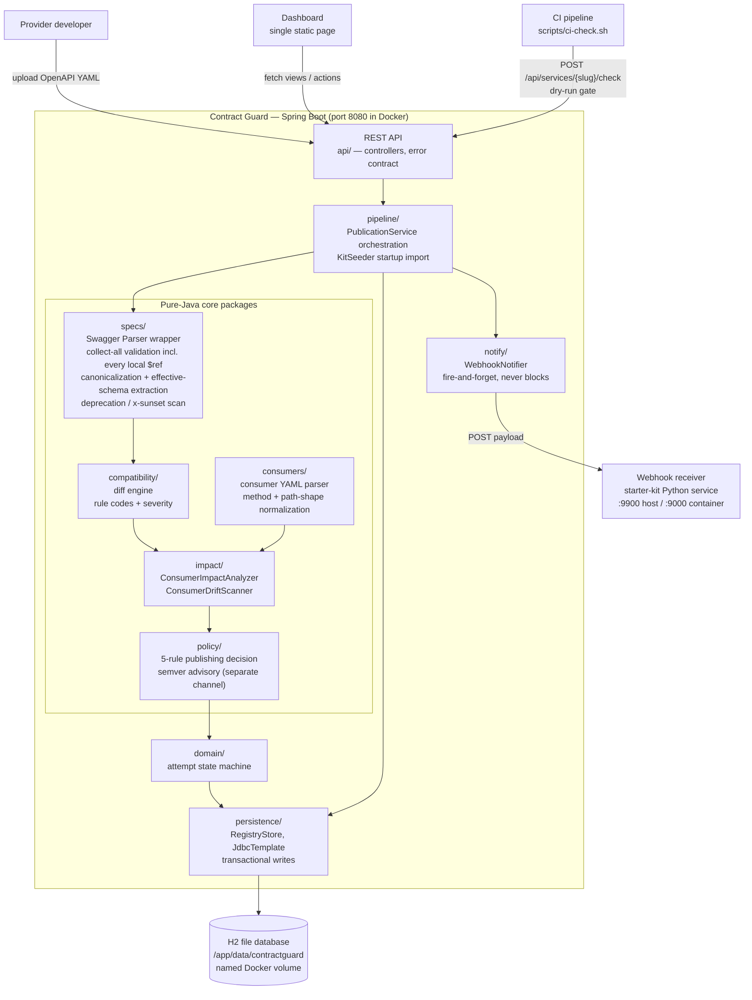
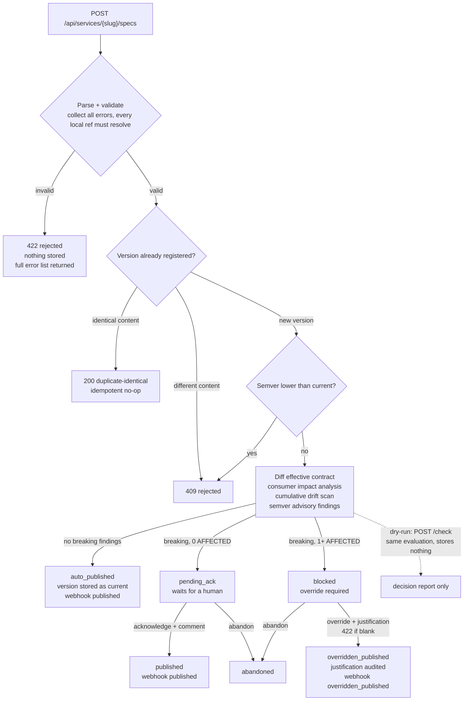

<div align="center">

# Contract Guard

**Stop breaking your consumers before you ship.**

Contract Guard is an API contract registry and publishing gate for microservice teams.
It parses your OpenAPI specification, compares the *effective wire contract* against the
currently published version, matches every breaking change against **who actually
consumes your API**, and blocks the publication — with a full audit trail, a justified
override path, webhook notifications, migration guides and CI enforcement.

[](https://adoptium.net)
[](https://spring.io/projects/spring-boot)
[](https://maven.apache.org)
[](https://www.h2database.com)
[](https://docs.docker.com/compose/)
[](https://www.python.org)

</div>

---

**OpenAPI validation is not compatibility.** A spec can be perfectly valid and still
silently break every client that reads a field you renamed or sends a parameter you made
required. Contract Guard closes that gap: it evaluates the **effective contract at each
wire location**, classifies every difference by an explicit request/response asymmetry
rule, cross-checks it against **declarative consumer usage files**, and gates the
publication on real blast radius — not on version numbers or good intentions.

- **Gate, not guess** — safe changes publish automatically; breaking changes either wait
  for a human acknowledgment or are blocked outright when a registered consumer is hit.
- **Consumers are first-class** — a breaking rename only matters if someone reads the old
  name; Contract Guard knows who, down to `premium.breakdown[].amount`.
- **Everything is auditable** — every attempt, finding, impact tier, decision and webhook
  delivery is persisted and queryable, with migration guides generated from stored facts.

| | Highlights |
|---|---|
| 🔍 | Effective-contract diffing that ignores cosmetic reorganizations (`$ref` renames, inlining, key order) and catches real wire changes |
| 🚦 | 4-outcome publishing gate: `auto_published` / `pending_ack` / `blocked` / `rejected` |
| 👥 | Consumer impact tiers: **AFFECTED** gates, **POSSIBLE** warns, **NONE** clears |
| 📋 | Migration guides, changelog, audit trail and workflow metrics from stored rows |
| 🔔 | Fire-and-forget webhooks to the untouched starter-kit receiver (never block publishing) |
| 🤖 | CI gate script with a strict exit-code contract (`scripts/ci-check.sh`) |
| 🐳 | One-command Docker Compose deployment with a persistent named volume |
| ✅ | 144 automated tests (unit + integration, in-memory H2) green at the final commit |

---

## Table of contents

1. [The problem](#1-the-problem)
2. [How Contract Guard works](#2-how-contract-guard-works)
3. [Architecture](#3-architecture)
4. [The publishing gate](#4-the-publishing-gate)
5. [Feature matrix](#5-feature-matrix)
6. [Compatibility semantics](#6-compatibility-semantics)
7. [Technology stack](#7-technology-stack)
8. [Quick start](#8-quick-start)
9. [Configuration](#9-configuration)
10. [Persistence & data lifecycle](#10-persistence--data-lifecycle)
11. [REST API](#11-rest-api)
12. [Consumer onboarding](#12-consumer-onboarding)
13. [CI integration](#13-ci-integration)
14. [Webhooks & metrics](#14-webhooks--metrics)
15. [Known limitations](#15-known-limitations)
16. [Project structure](#16-project-structure)

## 1. The problem

In a microservice landscape, **providers evolve their APIs and consumers depend on
exactly the shape they coded against** — specific operations, parameters and response
fields. Nothing in the toolchain normally stops a provider from:

- renaming a response field that a mobile app reads (`amount` → `value`),
- making a parameter required that nobody sends yet (`region`, `requestedBy`),
- removing a field that still appears in every response today (`legacyCode`),
- widening an enum so strict clients meet values they never handle (`EXPIRED`).

Ordinary OpenAPI validation says "fine" to all of the above: the documents are well-formed.
Semver says even less — a breaking change can ship under a minor bump and nobody notices
until a pager fires. The result is the classic distributed-systems failure: **the provider
ships, the consumer breaks at runtime, and the incident starts with "what changed?"**

## 2. How Contract Guard works

Contract Guard sits **between the provider and publication**:

1. **Parse & validate** — the uploaded OpenAPI 3.0 YAML/JSON is parsed (Swagger Parser)
   and walked structurally; every local `$ref` must resolve and all errors are collected
   (one broken upload yields the complete diagnosis, not the first error). Invalid specs
   are rejected with `422` and nothing is stored.
2. **Extract the effective contract** — at every wire location
   (`VERB /pathShape :: scope`) the schema is inlined, `$ref`-free, name-free and
   order-free, so reorganizations that don't touch the wire diff to *zero*.
3. **Diff against the published version** — every difference is classified by explicit
   compatibility rules with stable codes (`RESP.PROPERTY_RENAMED`,
   `REQ.REQUIRED_ADDED`, …) and severity (`breaking` / `warn` / `info`).
4. **Cross-check consumer usage** — declarative consumer YAML files (which operations
   each consumer calls, which fields it sends and reads) are matched against the findings
   to produce per-consumer impact: **AFFECTED**, **POSSIBLE**, or **NONE**.
5. **Gate the publication** — no breaking findings → auto-publish; breaking but zero
   affected consumers → wait for acknowledgment; any affected consumer → blocked until
   an explicit override with a mandatory written justification.
6. **Record everything** — attempts, findings, impact rows, state transitions, audit
   events and webhook deliveries are persisted transactionally; migration guides and
   metrics are generated from those stored facts.

## 3. Architecture

A modular monolith: one Spring Boot process, a pure-Java core (no framework annotations,
no I/O in `specs` / `compatibility` / `consumers` / `impact` / `policy`), Spring only at
the edges.



On first startup the **KitSeeder** pushes the bundled starter-kit specs through this same
real pipeline in filename order (idempotent — a `KIT_IMPORT` audit marker per service
skips re-imports), and the **ConsumerRegistry** loads the consumer declaration files.

## 4. The publishing gate

Every upload lands in exactly one outcome, decided by findings + impact — never by semver:



| Rule | Situation | Outcome | HTTP |
|---|---|---|---|
| 1 | No breaking findings | `auto_published` — version stored, webhook sent | 200 |
| 2 | Breaking, **0 AFFECTED** consumers | `pending_ack` — waits for the team's acknowledgment | 200 |
| 3 | Breaking with **≥ 1 AFFECTED** consumer | `blocked` — publish requires a justified override | 200 |
| 4 | Malformed / invalid spec | `rejected` — all errors listed, nothing stored | **422** |
| — | Identical re-upload | idempotent no-op | 200 |
| — | Same version, different content / version regression | rejected | **409** |
| — | Wrong-state decision action / blank fields | rejected | **400** |
| — | Override with blank justification | rejected | **422** |

Every transition is transactional: the state update is guarded by the expected previous
state, so two concurrent decisions cannot both apply — the loser's transaction (including
its transition and audit rows) rolls back and surfaces as `409`.

## 5. Feature matrix

| Capability | Status | Notes |
|---|---|---|
| Service registry (slug, title, owner, description) | ✅ implemented | slug-validated, audited, duplicate → 409 |
| OpenAPI YAML/JSON ingestion | ✅ implemented | JSON body `{"yaml", "filename"}`; multipart not used |
| Reference resolution & collect-all validation | ✅ implemented | every local `$ref` must resolve; all errors reported at once |
| Effective contract comparison | ✅ implemented | name-free, order-free, `$ref`-free wire locations |
| Breaking / non-breaking classification | ✅ implemented | explicit request/response asymmetry rule set |
| Property rename detection | ✅ implemented | removed+added, same parent, same type → one finding |
| Parameter serialization changes | ✅ implemented | `style` / `explode` / `allowReserved` (see §6) |
| Consumer YAML onboarding | ✅ implemented | loaded at startup from `consumers/`; **no REST re-upload** (documented) |
| Consumer impact analysis (AFFECTED / POSSIBLE / NONE) | ✅ implemented | per-finding evidence reasons |
| Cumulative consumer drift detection | ✅ implemented | non-gating `CONSUMER.DRIFT` / `CONSUMER.STALE_BINDING` warnings |
| Semver advisory analysis | ✅ implemented | separate findings channel, never gates |
| Deprecation & sunset lifecycle | ✅ implemented | `DEPRECATION.ADDED`, `SUNSET_PASSED`, `SUNSET_SCHEDULED` |
| Publishing governance (ack / override / abandon) | ✅ implemented | state-guarded, audited, justification enforced |
| Version history & changelog (with migration steps) | ✅ implemented | generated from stored findings |
| Migration guides per attempt | ✅ implemented | grounded in stored findings + impacts, consumers named |
| Audit trail | ✅ implemented | append-only transitions + audit events, filterable |
| Webhook notifications | ✅ implemented | durable delivery log; receiver inbox is in-memory (its own design) |
| Workflow metrics | ✅ implemented | aggregated from real rows |
| CI check script | ✅ implemented | strict exit-code contract (§13) |
| Docker deployment | ✅ implemented | two-file Compose override + persistent volume; local verification recorded in PROGRESS.md |
| `oneOf` exclusivity validation | ⚠️ documented limitation | alternatives compared as a set; exclusivity not interpreted |
| General regex subsetting for `pattern` changes | ⚠️ documented limitation | directional only vs the trivial all-accepting case |
| Self-service consumer registration API | ❌ not implemented | startup YAML loading only (planned A-08 upload endpoint was cut) |
| Authentication / RBAC | ❌ not implemented | `X-Acting-User` is attribution only |

## 6. Compatibility semantics

**Effective contract comparison, not text diffing.** Specs are compared as their
*effective* forms: every local `$ref` is inlined, component names erased, key order
normalized, and path placeholders treated positionally (`{id}` ≡ `{quoteId}`). The
classic trap — renaming `Premium` → `PremiumDetails` and inlining `Vehicle` — produces
**zero findings**; a real wire change produces exactly the right ones.

**The asymmetry principle.** The set of requests a server *accepts* may only grow, and
the guarantees it *makes* about responses may only grow. Hence:

- **Request side**: required-field additions, type/enum/constraint narrowing, property
  and parameter removals are **breaking**; relaxations are informational.
- **Response side**: property removals, required-guarantee removals, enum/type widening
  are **breaking**; a strengthened guarantee is informational. A documented *new*
  request schema narrows what servers accept (breaking); a documented *new* response
  schema strengthens the promise (informational).

**Nesting, arrays and renames.** Field paths keep wire shape
(`premium.breakdown[].amount`); a removed-and-added pair with the same parent and type is
reported once as `RESP.PROPERTY_RENAMED` with both names — so the mobile app reading
`premium.breakdown[].amount` is named as **AFFECTED** by `amount` → `value`, while a
consumer that never reads it is cleared.

**Parameters.** Parameters are matched by `(in, ordinal)` position — deliberately
**name-free**, so renaming a path parameter stays invisible while schema/required changes
are still caught. `required` flips, additions and removals are classified per the
asymmetry rule.

**Parameter serialization (`style`, `explode`, `allowReserved`).** These attributes
change how a value physically appears on the wire (`;id=3` vs `/3`,
`?ids=1&ids=2` vs `?ids=1,2`), so deviations from the OpenAPI defaults are captured in
the effective envelope. `PARAM.SERIALIZATION_CHANGED` fires:

- **style change → BREAKING** (always alters the wire format),
- **explode change → BREAKING for array/object parameters**, informational for
  single-valued ones (no wire-format change),
- **`allowReserved` disabled → BREAKING** (permission removed); enabled → informational.

Explicitly spelled-out defaults (e.g. `style: form, explode: true` on a query parameter)
are provably wire-neutral and produce no findings.

**Reference resolution.** Local `$ref`s are resolved everywhere — including inside
`parameters`, `requestBodies` and `responses` (a `$ref`-wrapped location compares
identically to its inline form). Circular references terminate at an opaque
`{"x-circular": "<wire path>"}` marker (component-name free, depth-capped at 50), so a
cyclic schema can be diffed without exploding.

**Compositions.** `allOf` branches are merged when they don't conflict (making
"move fields into an allOf branch" wire-neutral); conflicting branches keep their list.
`anyOf`/`oneOf` alternatives are compared as a **set**: reordering is cosmetic, and
added/removed branches follow the asymmetry rule. `oneOf` *exclusivity* is **not**
interpreted — see [limitations](#15-known-limitations).

## 7. Technology stack

| Layer | Technology | Why |
|---|---|---|
| Language | Java 17 (`maven.compiler.release=17`), built and run on JDK 21 | team direction; runs on any modern JDK |
| Framework | Spring Boot 4.1.2 (Web, Validation, JDBC starters) | REST + Bean Validation + SQL plumbing from one BOM |
| Build | Maven 3.9 | standard, multi-stage Docker build |
| OpenAPI parsing | Swagger Parser 2.1.48 | parses OAS 3.0/3.1, resolves local `$ref`s, typed model |
| YAML/JSON | Jackson 3 (`tools.jackson.*`) + Swagger Parser's Jackson 2 (coexist by design) | consumer files, canonical JSON, webhook payloads |
| Persistence | H2 in file mode + Spring `JdbcTemplate`, hand-written `schema.sql` | zero-dialect ORM-free thin DAOs; in-memory H2 for tests |
| Frontend | vanilla HTML/CSS/JS single page served from the jar | no build chain |
| Webhooks | Spring `RestClient` (2 s timeouts) → Python 3.12 stdlib receiver | fire-and-forget; failures logged, never fatal |
| Packaging | Docker multi-stage build (`maven:3.9-eclipse-temurin-21` → `eclipse-temurin:21-jre`) + two-file Compose | one-command full deployment |
| CI gate | Bash + curl + python3 (or python) | runs the real gate as a dry-run from any pipeline |
| Tests | JUnit 5, Spring Boot Test, MockMvc, AssertJ | 144 tests over in-memory H2 |

Deliberately absent: ORM/Hibernate, queues, auth systems, frontend build tooling,
Testcontainers, springdoc UI.

## 8. Quick start

### Prerequisites

- **Docker** with Compose v2 (everything runs in two containers), *or* for local
  development: JDK 21 + Maven 3.9 and Python 3.12 for the receiver.

### Run everything with Docker Compose (recommended)

```bash
git clone <this-repository> contract-guard
cd contract-guard

docker compose -f docker-compose.yml -f docker-compose.app.yml up --build -d
```

- **Dashboard:** http://localhost:8080 (override the host port with `PORT_APP`)
- **Webhook receiver inbox:** http://localhost:9900 (override with `WEBHOOK_PORT`)

On first start the kit is imported automatically: 3 services (`quote-api`, `policy-api`,
`claims-api`) with their planted breaking changes, the broken `$ref` spec rejected, and
the 4 consumer files registered. Verify:

```bash
curl -s http://localhost:8080/api/health
# {"status":"UP","service":"contractguard","webhook_url":"http://webhook-receiver:9000/contractguard","db":"UP"}
```

### Run locally without Docker

```bash
# 1. webhook receiver (starter kit, untouched)
python webhook-receiver/app.py                     # listens on :9000

# 2. Contract Guard (fresh DB: the app creates ./data automatically)
mvn spring-boot:run                                # UI on http://localhost:8000
```

The app defaults to `WEBHOOK_URL=http://localhost:9900/contractguard`; start the receiver
with `PORT=9900 python webhook-receiver/app.py`, or point the app at :9000 via
`WEBHOOK_URL=http://localhost:9000/contractguard`.

### Stopping, restarting and resetting

| Action | Command | Data effect |
|---|---|---|
| Restart the app only | `docker compose -f docker-compose.yml -f docker-compose.app.yml restart contract-guard` | registry data preserved (volume) |
| Stop everything | `docker compose -f docker-compose.yml -f docker-compose.app.yml down` | containers removed; **named volume retained** |
| Start again after `down` | `docker compose -f docker-compose.yml -f docker-compose.app.yml up -d` | data reloaded from the volume; kit re-import skipped (idempotent) |
| **Intentional reset** (fresh demo DB) | `docker compose -f docker-compose.yml -f docker-compose.app.yml down -v` | ⚠️ deletes the volume and all registry data — use deliberately, never as routine cleanup |

## 9. Configuration

All configuration is environment-driven (no hardcoded paths, ports or secrets):

| Env var | Default | Meaning |
|---|---|---|
| `PORT_APP` | `8000` local / `8080` in the image | HTTP port of Contract Guard |
| `WEBHOOK_URL` | `http://localhost:9900/contractguard` (local) · `http://webhook-receiver:9000/contractguard` (Compose) | webhook target |
| `DB_URL` | `jdbc:h2:file:./data/contractguard` | H2 file DB (the Compose override points it at the mounted volume) |
| `SPECS_DIR` | `specs` | read-only kit specs for the startup import |
| `CONSUMERS_DIR` | `consumers` | read-only kit consumer declarations, loaded at startup |
| `KIT_IMPORT` | `true` | run the idempotent kit import at startup |

## 10. Persistence & data lifecycle

- **H2 file database** accessed through `JdbcTemplate` (no ORM). Locally the file lives
  at `./data/contractguard.mv.db`; in Docker at `/app/data/contractguard` on the named
  volume `contractguard-data` (declared in `docker-compose.app.yml`).
- **What survives**: a container restart (nothing lost) and container recreation via
  `down` + `up` (volume retained) — verified in the release verification recorded in
  [PROGRESS.md](PROGRESS.md).
- **What is lost**: only a deliberate `down -v` (volume deletion) — the documented way to
  reset to a fresh demo database.
- **Schema safety**: `schema.sql` uses `CREATE TABLE IF NOT EXISTS` plus idempotent
  `ALTER TABLE` migrations, so an older local database upgrades in place at boot.
- **Durability split**: the `notifications` table is the durable webhook delivery log;
  the receiver's inbox is intentionally in-memory (starter-kit fixture behavior) and
  resets when that container is recreated.
- H2 is a **single-process** database: only the app opens the file; don't run a second
  app instance against the same `./data`.

## 11. REST API

All endpoints are JSON over HTTP under `/api`. Errors use `{"error": "message"}`;
invalid specs return `422` with the full collected error list and the audit attempt id.
Every mutating endpoint accepts the optional `X-Acting-User` header for audit
attribution (default `anonymous`; **attribution only, not authentication**).

### Health & registry

| Method & path | Purpose | Status codes |
|---|---|---|
| `GET /api/health` | liveness, DB status, webhook target | 200 |
| `GET /api/services` | registry overview (current version, counts) | 200 |
| `POST /api/services` | register a service — body `{"slug", "title?", "ownerTeam?", "description?"}` | 200 · 400 bad/missing slug · 409 already registered |
| `GET /api/services/{slug}` | service detail with versions and attempts | 200 · 404 |
| `GET /api/services/{slug}/versions` | version list with states | 200 · 404 |
| `GET /api/services/{slug}/versions/{version}` | stored spec + provenance (`sourceSha`, `publishedBy`, …) | 200 · 404 |

### Specification ingestion & dry-run

| Method & path | Purpose | Status codes |
|---|---|---|
| `POST /api/services/{slug}/specs` | run the full gate — body `{"yaml", "filename?"}` → attempt with state, findings, impacts, allowed actions | 200 · 400 blank body · 409 duplicate-differs/regression · 422 invalid spec |
| `POST /api/services/{slug}/check` | **dry-run**: same decision, stores nothing | 200 · 400 · 422 |
| `GET /api/services/{slug}/compare?from=V&to=V` | dry-run diff of two registered versions | 200 · 404 |

### Publishing governance

| Method & path | Purpose | Status codes |
|---|---|---|
| `GET /api/attempts/{id}` | attempt detail: state, findings, impacts, allowed actions | 200 · 404 |
| `GET /api/services/{slug}/attempts` | attempt summaries for one service | 200 · 404 |
| `POST /api/attempts/{id}/acknowledge` | publish a `pending_ack` attempt — body `{"comment?"}` | 200 · 400 wrong state |
| `POST /api/attempts/{id}/override` | publish a `blocked` attempt — body `{"justification"}` **non-blank** | 200 · 400 wrong state · 422 blank justification |
| `POST /api/attempts/{id}/abandon` | withdraw a `pending_ack`/`blocked` attempt | 200 · 400 wrong state |
| `GET /api/attempts/{id}/migration-guide` | migration steps from the attempt's stored findings + impacts | 200 · 404 |

### History, consumers, impact, audit, metrics, notifications

| Method & path | Purpose | Status codes |
|---|---|---|
| `GET /api/services/{slug}/history` | versions + attempts timeline | 200 · 404 |
| `GET /api/services/{slug}/changelog` | per-version entries with embedded migration steps | 200 · 404 |
| `GET /api/consumers` | registered consumers with declared bindings | 200 |
| `POST /api/impact` | standalone impact analysis — body `{"service", "oldSpec", "newSpec"}` (YAML text) | 200 · 400 missing fields |
| `GET /api/audit?service=&attempt=` | audit trail, filterable | 200 |
| `GET /api/notifications` | durable webhook delivery log | 200 |
| `GET /api/metrics` | workflow metrics aggregated from real rows | 200 |

### Representative calls

```bash
# register a service
curl -s -X POST http://localhost:8080/api/services \
  -H "Content-Type: application/json" \
  -d '{"slug":"payments-api","title":"Payments API","ownerTeam":"payments"}'

# dry-run the gate on a candidate spec (stores nothing)
python -c 'import json,sys; print(json.dumps({"yaml": open(sys.argv[1], encoding="utf-8").read(), "filename": sys.argv[2]}))' \
    specs/quote-api/3-price-lines.yaml 3-price-lines.yaml > /tmp/upload.json
curl -s -X POST http://localhost:8080/api/services/quote-api/check \
  -H "Content-Type: application/json" -H "X-Acting-User: alice" \
  -d @/tmp/upload.json

# upload for real (gate decides: auto_published / pending_ack / blocked)
curl -s -X POST http://localhost:8080/api/services/quote-api/specs \
  -H "Content-Type: application/json" -H "X-Acting-User: alice" \
  -d @/tmp/upload.json

# override a blocked publication (justification is mandatory, audited)
curl -s -X POST http://localhost:8080/api/attempts/14/override \
  -H "Content-Type: application/json" -H "X-Acting-User: alice" \
  -d '{"justification":"mobile-app confirmed the rename in writing"}'

# standalone consumer-impact analysis of any spec pair
python -c 'import json,sys; print(json.dumps({"service":"quote-api","oldSpec":open("specs/quote-api/2-reorganised.yaml",encoding="utf-8").read(),"newSpec":open("specs/quote-api/3-price-lines.yaml",encoding="utf-8").read()}))' > /tmp/impact.json
curl -s -X POST http://localhost:8080/api/impact -H "Content-Type: application/json" -d @/tmp/impact.json
```

## 12. Consumer onboarding

Consumers describe their real usage in small YAML files (this is the starter-kit format;
`consumers/` ships four of them):

```yaml
consumer: mobile-app          # unique name
team: Mobile
uses:
- provider: quote-api         # provider service slug
  method: GET                 # exact HTTP method
  path: /quotes/{id}          # template; placeholder NAMES are ignored (positions match)
  sends:                      # fields/parameters the consumer sends
  - id
  reads:                      # fields the consumer depends on in responses
  - quoteId
  - status
  - premium.total             # dots nest, [] marks array items
  - premium.breakdown[].amount
```

- **Parsing & validation**: `ConsumerParser` (Jackson 3 YAML) validates the shape and
  normalizes each binding to `method + path shape` (placeholder positions, not names —
  `/quotes/{id}` matches a spec's `/quotes/{quoteId}`). Field paths use the same
  coordinate system as findings (`dots` for nesting, `[]` after array properties).
- **Loading**: the `ConsumerRegistry` reads every file in the configured `consumers-dir`
  **at startup**; the files are treated as read-only kit fixtures.
- **Onboarding another consumer**: add a YAML file with the format above to the
  `consumers/` directory (or the mounted `CONSUMERS_DIR`) and **restart the application**
  — declarations are loaded at startup, not hot-reloaded.
- **Explicitly not implemented**: self-service consumer registration through a REST API
  or dashboard upload. `GET /api/consumers` is read-only. This is a documented scope cut,
  not an oversight (see [DECISIONS.md](DECISIONS.md) A-08).

## 13. CI integration

`scripts/ci-check.sh` runs the **real gate as a dry-run** (`POST /api/services/{slug}/check`)
and fails the pipeline when the candidate would damage a registered consumer.
Requires `curl` and `python3` (or `python`).

```bash
scripts/ci-check.sh --base-url http://localhost:8080 \
  --service quote-api --spec specs/quote-api/3-price-lines.yaml [--strict] [--actor ci-bot]
```

Exit-code contract (verified against the implementation):

| Code | Meaning |
|---|---|
| `0` | `PUBLISH` — no consumer-impacting breaking change; or `PENDING_ACK` without `--strict` (breaking but zero AFFECTED consumers — the real publish still needs a human acknowledgment) |
| `1` | `BLOCKED` — breaking change with ≥ 1 AFFECTED consumer; with `--strict`, also `PENDING_ACK` |
| `2` | HTTP 422 — the candidate spec itself is invalid (malformed YAML, broken `$ref`, …) |
| `3` | operational failure — server unreachable, non-JSON response, unexpected HTTP status |
| `4` | usage error — missing arguments, unreadable spec file, unknown argument, missing curl/python |

Typical pipeline usage: run after unit tests against a running Contract Guard instance;
`exit 1` blocks the merge, `exit 2` signals a spec defect, and the printed findings give
the author the exact locations and affected consumers.

## 14. Webhooks & metrics

**Webhooks** fire after the publication transaction commits (fire-and-forget, 2 s
connect/read timeouts, **single delivery attempt — no retry**; every failure mode is
recorded in the `notifications` table with a compact status and logged, and can never
block the already-committed publication). Delivered kinds: `published`,
`overridden_published` (with the justification) and `blocked`. The payload carries a
count-capped summary of the **breaking and warn** findings. Payload shape:

```json
{
  "event": "blocked",
  "service": "quote-api",
  "version": "2.0.0",
  "decision": "blocked",
  "actor": "alice",
  "affected_consumers": ["mobile-app"],
  "findings": [{"code": "RESP.PROPERTY_RENAMED", "severity": "breaking",
                "location": "POST /quotes :: response:201:application/json",
                "field_path": "premium.breakdown[].amount"}],
  "timestamp": "2026-11-18T14:24:00Z"
}
```

**Metrics** (`GET /api/metrics`) aggregate real rows: services, published/superseded
versions, publication attempts by state, findings by severity, breaking total, AFFECTED
impacts by consumer, blocked/overridden/rejected counts, webhook delivery statuses and
audit-event count. The dashboard renders the same data.

## 15. Known limitations

- **`oneOf` exclusivity is not interpreted** — alternatives are compared as a set;
  mutual-exclusion changes are not detected (documented in the engine).
- **Regex subsetting for `pattern` changes is limited** to the trivial all-accepting
  case; other pattern changes report an explicit "direction cannot be determined"
  finding instead of guessing.
- **Serialization styles** are compared by value (`style`/`explode`/`allowReserved`);
  style-specific wire renderings beyond the documented OAS defaults (e.g. `deepObject`)
  are not individually modeled.
- **Consumer onboarding is YAML-based and loaded at startup** — no self-service
  registration API or dashboard upload, and no hot reload (restart required).
- **`X-Acting-User` is attribution, not authentication** — no auth/RBAC by documented
  scope decision.
- **H2 is a single-process file database** — one app instance per data file; a network
  DB would be needed for horizontal scale-out.
- **The receiver inbox is in-memory** (starter-kit fixture); the `notifications` table is
  the durable log.
- Cycle-cut expansion means changes *deep inside* a cyclic schema beyond the
  `x-circular` marker are not compared.

## 16. Project structure

```
├── docker-compose.yml            # starter-kit receiver — UNTOUCHED fixture
├── docker-compose.app.yml        # override: adds the app + named volume + wiring
├── Dockerfile                    # multi-stage app image (Maven build → JRE runtime)
├── scripts/ci-check.sh           # CI gate with the documented exit-code contract
├── specs/                        # starter-kit OpenAPI specs — UNTOUCHED fixtures
│   ├── quote-api/  (1-initial → 4-ncb-and-taxes)
│   ├── policy-api/ (1-initial → 4-endorsement-rules)
│   └── claims-api/ (1-initial → 4-approval-later; file 2 plants the broken $ref)
├── consumers/                    # starter-kit consumer declarations — UNTOUCHED fixtures
├── webhook-receiver/             # starter-kit Python receiver — UNTOUCHED fixtures
├── src/main/java/com/contractguard/
│   ├── api/          # REST controllers, error contract, health
│   ├── specs/        # parsing, validation, canonicalization, effective schemas
│   ├── compatibility/# diff engine, finding codes, location keys
│   ├── consumers/    # consumer YAML parsing + binding normalization
│   ├── impact/       # impact analyzer + cumulative drift scanner
│   ├── policy/       # 5-rule decision + semver advisory
│   ├── pipeline/     # PublicationService, KitSeeder, MigrationGuide
│   ├── domain/       # attempt state machine
│   ├── persistence/  # RegistryStore (JdbcTemplate) + schema.sql
│   └── notify/       # WebhookNotifier
├── src/main/resources/static/index.html   # dashboard (single page, no build chain)
├── src/test/java/      # 19 test classes, 144 tests (in-memory H2)
├── PLAN.md             # original plan + as-built status
├── PROGRESS.md         # milestone-by-milestone engineering journey
├── DECISIONS.md        # architecture decisions & trade-offs
└── REVIEW.md           # engineering review of the finished implementation
```

The starter-kit fixtures (`specs/`, `consumers/`, `webhook-receiver/`, original
`docker-compose.yml`) are **never modified** — the app overrides behavior via
`docker-compose.app.yml` and reads the fixtures read-only.

## Documentation

- [PLAN.md](PLAN.md) — original architecture plan and the as-built status of every requirement
- [PROGRESS.md](PROGRESS.md) — the milestone-by-milestone build journey with verification evidence
- [DECISIONS.md](DECISIONS.md) — decision log with rationale, alternatives and consequences
- [REVIEW.md](REVIEW.md) — engineering review: verified properties, capabilities, limitations
